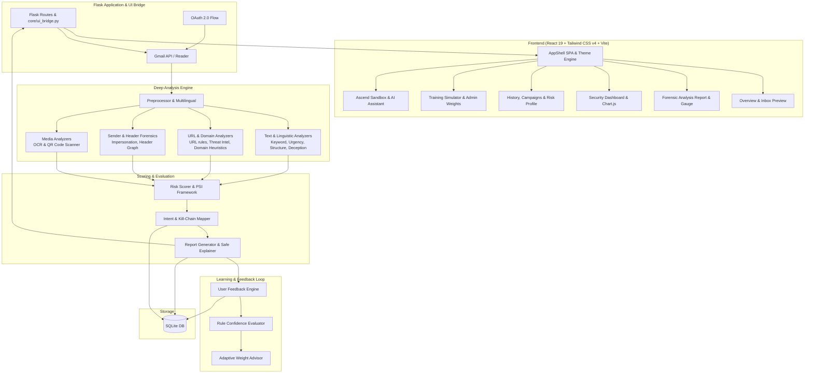

# 🛡️ PhishGuard — Explainable Phishing Email Risk Analyzer

> A novel, explainable phishing detection system that analyzes real Gmail emails via OAuth, assigns transparent risk scores with feature-wise contribution breakdowns, classifies phishing intent, and provides human-readable awareness alerts.

---

## 🎯 Project Novelty

Unlike black-box ML phishing detectors, PhishGuard provides **complete transparency**:

| Feature | PhishGuard | Traditional ML Detectors |
|---|---|---|
| Explainability | ✅ Every decision explained | ❌ Black-box predictions |
| Feature Contributions | ✅ Per-analyzer score breakdown | ❌ Hidden feature importance |
| Real Email Analysis | ✅ Live Gmail integration | ❌ Usually offline datasets |
| Intent Classification | ✅ 5 categories with reasoning | ❌ Binary safe/phishing |
| User Awareness | ✅ Contextual safety tips | ❌ No educational component |
| Privacy | ✅ Read-only, no body storage | ⚠️ Varies |

---

## 🏗️ Architecture



---

## 📋 Prerequisites

- Python 3.10+ (already configured in `.venv`)
- Node.js 18+ and npm (only required if modifying/rebuilding the React frontend in `frontend/`)
- A Google Cloud project with Gmail API enabled (for live Gmail inbox scanning; training simulations, dashboards, and tests run offline without it)

---

## 🔧 Setup Instructions

### 1. Google Cloud OAuth Credentials

1. Go to [Google Cloud Console](https://console.cloud.google.com/)
2. Create a new project (or select an existing one)
3. Navigate to **APIs & Services → Library**
4. Search for **Gmail API** and **Enable** it
5. Go to **APIs & Services → Credentials**
6. Click **Create Credentials → OAuth 2.0 Client ID**
7. Select **Web Application** as the application type
8. Add both `http://localhost:5000/oauth/callback` and `http://127.0.0.1:5000/oauth/callback` to **Authorized redirect URIs**
9. Download the JSON file and save it as `credentials.json` in the project root
10. Go to **OAuth Consent Screen** and add your Google account as a **Test User**

### 2. Environment Configuration (Optional)

Copy `.env.example` to `.env` to configure your API keys (e.g., Google Gemini for AI chatbot and translation, VirusTotal, Safe Browsing):

```bash
copy .env.example .env     # Windows CMD
cp .env.example .env       # PowerShell / Bash
```

### 3. Install Dependencies

**Backend (Python):**
```bash
# Windows (.venv)
.venv\Scripts\pip.exe install -r requirements.txt

# Or with an active virtualenv / system python
pip install -r requirements.txt
```

**Frontend (React + Tailwind CSS — pre-built in `static/dist/`, rebuild only when editing UI):**
```bash
cd frontend
npm install
npm run build
cd ..
```

### 4. Run the Application

Start PhishGuard using any of the following methods (pre-built React assets are served directly by Flask on port `5000`):

- **Windows Batch (Double-click or CMD)**:
  ```cmd
  run.bat
  ```

- **PowerShell**:
  ```powershell
  .\run.ps1
  ```

- **Python CLI runner**:
  ```bash
  python run.py
  # or with custom options
  python run.py --port 5000 --host 127.0.0.1
  ```

- **Frontend Hot-Reload Development Mode (Optional)**:
  Run Flask (`python run.py`) in one terminal and Vite in another:
  ```bash
  cd frontend
  npm run dev
  ```
  Open `http://localhost:5173` for Vite HMR proxied to Flask, or **http://127.0.0.1:5000** for the production build.

### 5. Run Tests (No Gmail Credentials Needed)

PhishGuard includes a unified test runner executing all 8 backend/engine test suites:

```bash
.venv\Scripts\python.exe run_tests.py
```

Or run individual suites in `tests/`:

```bash
.venv\Scripts\python.exe tests/test_engine.py
.venv\Scripts\python.exe tests/test_ascend.py
```

---

## 🧩 Project Structure

```text
Phish-Guard/
├── app.py                     # Flask application, OAuth & API endpoints
├── config.py                  # Central configuration, paths & .env loader
├── run.py                     # CLI launcher & server entry point
├── run.bat                    # Windows 1-click batch launcher
├── run.ps1                    # Windows PowerShell launcher
├── run_tests.py               # Unified test runner (8 suites)
├── requirements.txt           # Python dependencies
├── .env.example               # Environment variables template
├── .gitignore                 # Git ignore rules
│
├── frontend/                  # React 19 + Tailwind CSS v4 + Vite source
│   ├── package.json           # Frontend dependencies & Vite scripts
│   ├── vite.config.js         # Builds to static/dist/ + dev server proxy
│   └── src/
│       ├── main.jsx           # React entry point
│       ├── App.jsx            # Client page router & ErrorBoundary
│       ├── index.css          # Tailwind v4 tokens, Dark/Light theme ramps
│       ├── context/
│       │   └── AppContext.jsx # SPA navigation, theme state, flash & toasts
│       ├── components/
│       │   ├── AppShell.jsx   # 248px sidebar workbench, top bar, alerts
│       │   ├── AppLink.jsx    # SPA link helper preserving native navigation
│       │   ├── ChatbotWidget.jsx # Context-aware AI assistant drawer
│       │   ├── ErrorBoundary.jsx # View error boundary
│       │   ├── Icons.jsx      # Unified Lucide vector icons
│       │   └── RiskBadge.jsx  # Semantic severity badges & score chips
│       └── pages/             # 13 React page views matching all Flask routes
│           ├── HomePage.jsx
│           ├── InboxPage.jsx
│           ├── ReportPage.jsx
│           ├── HistoryPage.jsx
│           ├── DashboardPage.jsx
│           ├── CampaignsPage.jsx
│           ├── RiskProfilePage.jsx
│           ├── TrainingPage.jsx
│           ├── AdminWeightsPage.jsx
│           ├── AscendDashboardPage.jsx
│           ├── WhatIfPage.jsx
│           ├── IncidentReportPage.jsx
│           └── AboutPage.jsx
│
├── core/                      # Detection engine, scoring & intelligence services
│   ├── __init__.py            # Core package exports
│   ├── ui_bridge.py           # Serializes Flask props for HTML hydration & SPA JSON
│   ├── phishing_engine.py     # Main engine (orchestrates analyzers)
│   ├── preprocessor.py        # Email text & HTML preprocessing
│   ├── risk_scorer.py         # Risk scoring & intent classification
│   ├── severity_index.py      # Phishing Severity Index (PSI)
│   ├── safe_explainer.py      # Explain why an email is safe
│   ├── killchain.py           # Cyber kill-chain / MITRE mapping
│   ├── header_forensics.py    # Email header & SPF/DKIM analysis
│   ├── header_graph.py        # Visual route graph for email hops
│   ├── domain_heuristics.py   # Domain typosquatting & heuristics
│   ├── threat_intel.py        # External threat feed integration
│   ├── linguistic_deception.py# Psycholinguistic manipulation checks
│   ├── multilingual.py        # Multilingual translation & analysis
│   ├── ocr_analyzer.py        # Image OCR text extraction
│   ├── qr_analyzer.py         # QR code detection & threat check
│   ├── sender_trust.py        # Sender domain trust & reputation
│   ├── user_profile.py        # User behavioral risk profiling
│   ├── risk_profile.py        # User risk exposure breakdown
│   ├── campaign_detector.py   # Cross-email campaign clustering
│   ├── training_sim.py        # Interactive simulation scenarios
│   ├── weekly_summary.py      # Weekly security digest & trends
│   ├── feedback.py            # User feedback collection
│   ├── rule_confidence.py     # Rule precision & confidence tracker
│   ├── weight_advisor.py      # Adaptive scoring weight advisor
│   ├── chatbot_service.py     # Context-aware AI chatbot service
│   ├── chatbot_blueprint.py   # Chatbot API routes blueprint
│   ├── gmail_auth.py          # Gmail OAuth 2.0 flow handler
│   ├── gmail_reader.py        # Gmail inbox retrieval & parser
│   └── database.py            # SQLite database models & logs
│
├── ascend/                    # Advanced cognitive & explainability framework
│   ├── ascend_blueprint.py    # Ascend routes & simulation API
│   ├── counterfactual.py      # Counterfactual "What-If" reasoning
│   ├── whatif_sandbox.py      # Educational weight simulation
│   ├── psych_analyzer.py      # Psychological manipulation analyzer
│   ├── threat_ontology.py     # Attack intent ontology mapper
│   ├── risk_forecast.py       # Human vulnerability forecaster
│   ├── incident_reporter.py   # Autonomous executive incident reports
│   └── rule_feedback.py       # Adaptive rule weight adjustment
│
├── tests/                     # Offline test suites (8 suites)
│   ├── test_engine.py         # Core detection pipeline tests
│   ├── test_ascend.py         # Ascend framework tests
│   ├── test_header_features.py# Header forensics tests
│   ├── test_image_features.py # OCR & QR code tests
│   ├── test_multilingual.py   # Multilingual detection tests
│   ├── test_risk_profiling.py # User profiling tests
│   ├── test_threat_intel.py   # Threat feed tests
│   ├── test_chatbot_context.py# Chatbot context injection tests
│   └── test_chatbot_api.py    # Chatbot API live endpoint tests
│
├── design-system/             # Persisted UI/UX Pro Max design system specs
│   └── phishguard/MASTER.md
│
├── data/                      # Persistent SQLite storage
│   └── phishing_logs.db       # Analysis logs & risk trends
│
├── scripts/                   # Utility & developer scripts
│   ├── debug_gemini.py        # Gemini API connectivity debugger
│   └── download_react.py      # Legacy vendor asset helper
│
├── static/
│   ├── dist/                  # Built Vite React + Tailwind CSS production bundle
│   │   └── assets/
│   │       ├── app.js
│   │       └── app.css
│   └── images/logo.png
│
└── templates/
    └── react_app.html         # Server-hydrated React shell template
```

---

## 🔍 How the Scoring Engine Works

### The Primary Analyzers

Each analyzer independently evaluates one aspect of the email and returns scored **Findings** — each with evidence and a human-readable explanation.
The system features an adaptive weighting system, but base scores are configured logically:

#### 1. 🔤 Keyword & Linguistic Analyzer (Max 25 pts)
Scans subject + body for phishing phrases and linguistic deception using NLP.
- Known phishing keywords (e.g., "account suspended") → 5 pts each
- Manipulative linguistics and artificial urgency → up to 15 pts

#### 2. 🔗 URL & Domain Analyzer (Max 25 pts)
Detects red-flag URLs and anomalous domains:
- **Shortened links**, **IP-based URLs**, or **Excessive subdomains** (5-10 pts)
- **Anchor text mismatch** (display text ≠ href) → 10 pts
- Enhanced by **Threat Intelligence** and **Domain Heuristics**.

#### 3. 👤 Sender, Trust & Header Forensics (Max 20 pts)
Inspects the identity and transit history:
- **Brand impersonation** or **Free email for corporate claims**
- Evaluates domain history against historical safety (**Sender Trust**)
- Analyzes payload headers to find forged routes (**Header Forensics**)

#### 4. ⏰ Urgency & Structure Analyzer (Max 15-30 pts)
Detects psychological pressure and structural flaws:
- Urgency phrases, ALL CAPS, or excessive punctuation.
- **Generic greetings** and **Credential requests** (mentions passwords, SSN, etc.).

#### 5. 🖼️ Media Analyzer (OCR & QR)
Performs deep-dive extraction on attached contents:
- Scans attachments for **QR Codes**, evaluating the embedded URLs safely.
- Executes **Optical Character Recognition (OCR)** to find text attempting to bypass standard spam filters inside images.

### Advanced Risk Transformation & Kill-chain Mapping

- **Total Score**: Sum of all findings aggregated through the main engine.
- **Phishing Severity Index (PSI)**: Normalizes raw scores into actionable risk.
- **Cyber Kill-Chain Mapper**: Contextualizes the detected threats against phases (e.g., Delivery, Execution, Action on Objectives).
- **Campaign Detection**: Groups similar emails to spot ongoing targeted attacks toward an organization.
- **Adaptive Rule Weights**: Administrative feedback loop tweaks analyzer maximum scores based on user-reviewed hit rates!

---

## 🎓 Academic Explanation

### Explainability Approach

PhishGuard implements **rule-based explainable AI (XAI)** principles:

1. **Modular decomposition**: Each analyzer operates independently with a fixed maximum score, making contributions directly interpretable.

2. **Evidence-based reasoning**: Every finding links to a specific piece of evidence extracted from the email (a keyword, URL, sender pattern, etc.).

3. **Additive scoring**: The total risk score is a simple, transparent sum of individual contributions — no hidden weights or learned parameters.

4. **Human-in-the-loop**: The system provides awareness tips and explanations, empowering users to make informed decisions rather than automating actions.

5. **Feature attribution**: The per-analyzer contribution chart provides a direct feature-importance breakdown analogous to SHAP/LIME explanations but without the complexity of post-hoc interpretation.

### Ethical Design Principles

- **Privacy-preserving**: Only Gmail metadata and analysis results are stored; full email bodies are never persisted.
- **Read-only access**: The OAuth scope (`gmail.readonly`) prevents any modification to the user's mailbox.
- **No automated actions**: The system never moves, deletes, or modifies emails — it only analyzes and advises.
- **Transparency**: Users see exactly why an email is flagged, fostering cybersecurity awareness.

---

## 📄 License

This project is for educational and research purposes.
